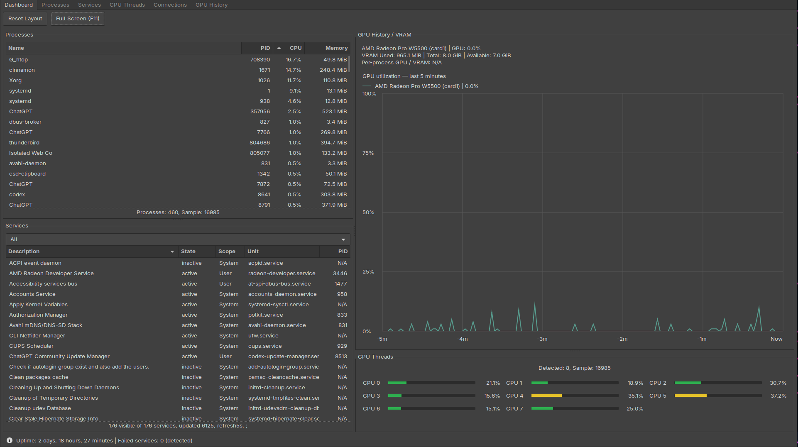
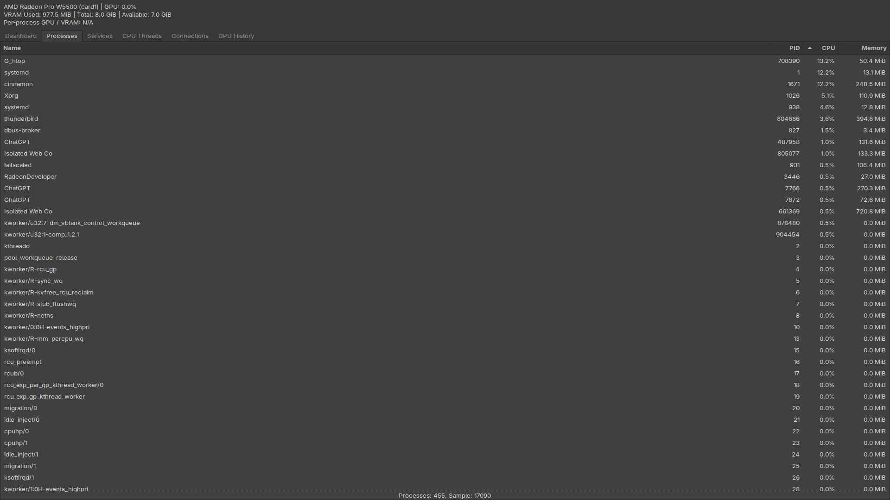

# G_htop Community Edition 1.1.0

A read-only process, service, CPU, network, and GPU monitor using C++17 and gtkmm 3. The four-panel dashboard combines processes, services, one shared multi-GPU graph and CPU meters. Community Edition is free and open source; G_htop Pro is the separately purchased professional edition.

## Windows and Linux

Linux 1.1.0 packages are available from the [existing release](https://github.com/DonHunt/g-htop/releases/tag/v1.1.0).
Windows 11 x64 support is prepared on the Windows review branch and awaits owner
native validation before binary publication. See [BUILD-WINDOWS.md](BUILD-WINDOWS.md)
and [WINDOWS_RELEASE_NOTES.md](WINDOWS_RELEASE_NOTES.md) for build, portable
packaging and testing instructions. No Windows download is advertised yet.

The UI, layout, shared GPU colors and About/Pro link are shared across both
platforms. Windows uses native process, service, PDH, DXGI and IP Helper APIs;
metrics unavailable from Windows or a driver show N/A. Wine automatically uses the packaged font configuration for readable text.
Windows CPU/GPU counters unavailable in Wine remain N/A; the GPU chart explains
that native Windows testing is required. The detailed Linux behavior and build
instructions below remain applicable to Linux.

## Screenshots (Linux)



*Dashboard with processes, services, GPU history and VRAM, and CPU thread meters.*



*Processes view showing process names, PIDs, CPU utilization, and memory usage.*

Launch **G_htop** from the Cinnamon application menu. In **Processes**, click Name, PID, CPU, or Memory to sort; click again to reverse. Process measurements refresh about every two seconds. One fully occupied logical core equals 100% CPU; the first sample initializes counters. Memory is resident memory, including shared pages.

In **Services**, choose All, Active, Inactive, or Failed. Click Description, Unit, Status, or Scope to sort. Both the system manager and your user manager are queried in the background about every five seconds. MainPID is the service's main process when available; N/A is normal for inactive and completed oneshot services. Status displays systemd's reported active state, including activating and deactivating when observed.

Discovery covers loaded service units, including loaded inactive units; installed units that systemd has not loaded are not enumerated. Aliases are deduplicated by canonical unit name within each scope. Query failures appear below the table; no root access is required. There are no service-management or process-termination controls. 

The shared GPU panel automatically detects AMD, NVIDIA and Intel PCI/DRM devices and refreshes about every two seconds. Each detected GPU has its own colored utilization line and compact legend in one five-minute graph. Device identity keeps same-model cards separate; colors and histories survive discovery reordering. Missing telemetry displays N/A and breaks the line; a genuine zero remains zero. Hover over the graph for full device identification, temperature, device/package power and used/total/available VRAM where the driver exposes them. Available VRAM is total minus used. GPU discovery runs in a background worker and refreshes automatically; replaced devices do not inherit an old card's history. No root access or GPU controls are required. Optional NVML uses an already-installed NVIDIA driver; no NVIDIA SDK or utility is bundled or required to launch. The optional `hwdata` PCI database supplies descriptive names. Per-process GPU utilization and VRAM attribution remain unavailable.

The **CPU Threads** tab shows a wrapping grid of logical CPU meters. It reads `/proc/stat` approximately every two seconds and computes utilization from successive counter differences (idle includes I/O wait; guest time is not double-counted). The first sample and unavailable/reset counters show N/A. Bars are green at 0–33%, yellow above 33% and below 67%, and red at 67–100%; text and other controls keep the current GTK theme. Resize the window to change the number of meter columns; the panel scrolls for large CPU counts.

The **Connections** tab lists TCP, TCP6, UDP, and UDP6 sockets in the current network namespace, including local/remote addresses and ports, socket states, and accessible owners. It queries the installed `ss` utility in a background worker approximately every two seconds without DNS lookups or root access. Filters are All, Listening (TCP LISTEN), Established (ss ESTAB, including connected UDP), and UDP. Click headings to sort; PIDs and ports sort numerically. Unknown/N/A ownership is normal for inaccessible processes and sockets without a live owner. Shared sockets may have one row per distinct owning PID; process/socket exits can race with collection. It has no disconnect, termination, or firewall controls.

The **GPU History** tab uses that same shared graph and worker, with a fixed 0–100% scale covering the last five minutes. History starts empty at launch and stays in memory only. No separate per-GPU panels are created.

The initial **Dashboard** view combines Processes and Services on the left, with GPU History/VRAM and CPU Threads on the right. Drag the middle divider to resize the columns; each column has its own independent horizontal divider. Process and service tables scroll inside their panels. The original detailed tabs remain available and share the same widgets and sampling workers; filters, sorting, and history carry between views.

Press **F11** or **Full Screen (F11)** to toggle full-screen Dashboard; **Escape** leaves full-screen. Move the normal window to another monitor using Cinnamon's usual window controls before entering full-screen. G_htop does not change monitor settings. Normal window dimensions and divider proportions are saved on close in `~/.config/G_htop/layout`; restoration clamps the layout to available space. **Reset Layout** balances the three dividers. The bottom dashboard strip stays outside the resizable panels and displays `/proc/uptime`, the number of failed services in the current system/user discovery cache, and detected service/GPU/VRAM availability issues. A count of zero is not a general system health assessment.

Presentation follows the active GTK theme, with one-decimal percentages and MiB/GiB values, right-aligned numeric columns, and numeric sorting independent of display formatting. Hover over the shared GPU graph for full telemetry and device identification. Long process and service descriptions use ellipses and full-name tooltips; Services places state and scope near the description, with further fields available by horizontal scrolling. CPU meters wrap more compactly. The status strip uses native informational/warning icons; a warning indicates a detected monitoring condition, not a general system health assessment.

## Linux requirements

G_htop Community 1.1.0 supports Linux with readable `/proc`, C++17, CMake 3.16+, pkg-config,
and gtkmm 3 (GTK 3). System/user services use `systemctl` from systemd; network
connections use `ss` from iproute2; bounded helper calls use `timeout` from
coreutils. GPU telemetry depends on accessible driver sysfs counters or optional NVIDIA NVML.
The `hwdata` PCI database is optional for descriptive GPU names. No root access is
needed for ordinary monitoring. Windows build requirements are documented separately above. No macOS or iOS edition is provided.

On Arch/Manjaro, install build prerequisites through your normal package manager:
`base-devel cmake pkgconf gtkmm3`. Runtime package dependencies are declared in
`packaging/arch/PKGBUILD.in`; hwdata is optional. The desktop uses its existing
GTK theme and icon infrastructure.

## Build and install from source

```sh
cmake -S . -B build -DCMAKE_BUILD_TYPE=Release -DCMAKE_INSTALL_PREFIX=/usr/local
cmake --build build --parallel 2
./build/G_htop
# Optional installation, performed only when you choose to install:
sudo cmake --install build
```

The installation prefix is configurable. Standard installs place the executable
in `bin`, the launcher in `share/applications/org.ghtop.Monitor.desktop`, the
project icon in `share/icons/hicolor/scalable/apps`, documentation in
`share/doc/G_htop`, and LICENSE/NOTICE in `share/licenses/g_htop`, all under the
chosen prefix. Add a nonstandard prefix's `bin` directory to PATH before using
the launcher. `DESTDIR` staging is supported without root.

To uninstall a manual CMake installation, retain that build directory and review
its `build/install_manifest.txt`, then remove exactly the recorded files:

```sh
sudo xargs -r -d '\n' rm -f -- < build/install_manifest.txt
```

This preserves parent directories and your `~/.config/G_htop/layout`. Do not use
a manifest from a different installation. Prefer the package manager for packaged
installations.

## Arch/Manjaro package

The local release bundle contains the source archive, an installable x86_64
package, a checksum-pinned PKGBUILD, SHA256SUMS and release notes. From that
bundle, verify checksums and optionally rebuild without root or automatic
dependency installation:

```sh
sha256sum -c SHA256SUMS
makepkg
```

The source archive includes the PKGBUILD template. Its `@SOURCE_SHA256@` token is
replaced with the completed archive's hash in the adjacent final PKGBUILD; the
final PKGBUILD is outside the source archive to avoid a self-referential hash.
The pinned recipe uses the custom source archive supplied with the GitHub release.

Installation and upgrades:

```sh
sudo pacman -U ./g_htop-1.1.0-1-x86_64.pkg.tar.zst
# Future upgrade: use pacman -U with the newer reviewed package.
# Removal:
sudo pacman -R g_htop
```

Do not manually delete package-managed files. User layout preferences are kept on
removal. The packaged desktop ID is `org.ghtop.Monitor`; an existing development
launcher with another ID is not overwritten. Both menu entries may be named
G_htop. Close a running development instance before launching an installed copy,
since GTK's application ID is shared. Package acceptance uses disposable user namespaces and an isolated configuration;
the host development copy and launcher are preserved.

## License and release review

Copyright © 2026 Donald E. Hunt. Copyright holder: Donald E. Hunt.

G_htop Community is licensed under Apache License, Version 2.0; see LICENSE and
NOTICE. Dependencies retain their own licenses (LICENSES.md). The copyright
holder and Community license were explicitly confirmed by the project owner.
Community is free and open source. **About** includes a conventional link to
[G_htop Pro](https://don-hunt.com/G_htopPro/), the separately purchased
professional edition. Following the link opens your browser; it does not change
Community features, collect license credentials, or require a purchase.
Pro source code, commercial licensing and activation are not included in this
Community distribution.

Source and releases: https://github.com/DonHunt/g-htop

## DEB, RPM and AppImage

The [v1.1.0 GitHub Release](https://github.com/DonHunt/g-htop/releases/tag/v1.1.0)
provides the source archive, Arch/Manjaro package, Ubuntu-built DEB, Fedora-built RPM,
and portable AppImage, plus checksums and tested-platform notes.

| Format | Verified build/runtime | File |
| --- | --- | --- |
| Arch/Manjaro | Current Manjaro x86_64 | `g_htop-1.1.0-1-x86_64.pkg.tar.zst` |
| DEB | Ubuntu 22.04 amd64 | `g-htop_1.1.0-1_amd64.deb` |
| RPM | Fedora 43 x86_64 | `g_htop-1.1.0-1.x86_64.rpm` |
| AppImage | Ubuntu build; tested on Manjaro, Ubuntu 22.04, Fedora 43 | `G_htop-1.1.0-x86_64.AppImage` |

```sh
sudo apt install ./g-htop_1.1.0-1_amd64.deb
sudo dnf install ./g_htop-1.1.0-1.x86_64.rpm
chmod +x ./G_htop-1.1.0-x86_64.AppImage
./G_htop-1.1.0-x86_64.AppImage
# If FUSE mounting is unavailable:
APPIMAGE_EXTRACT_AND_RUN=1 ./G_htop-1.1.0-x86_64.AppImage
```

Verify `SHA256SUMS` first and close running Community instances before upgrading.
DEB/RPM installation, baseline upgrade, launch and removal were verified in isolated
native userspaces with the host kernel/display. AppImage bundles GTK/gtkmm libraries
from Ubuntu 22.04 and uses X11/XWayland; it retains host glibc and monitoring helpers.
Distribution compatibility depends on native dependencies; no every-distribution or
other-architecture claim is made. `PLATFORMS.md` on the release gives exact scope.
Corresponding AppImage runtime sources and third-party notices are supplied.

Native recipes are in `packaging/cpack`, `packaging/deb` and `packaging/rpm`; their
host-family guard prevents relabeling a Manjaro binary as a native DEB/RPM.
The v1.1.0 tag and original source/Arch assets remain unchanged. Additional formats
were published after that source freeze; current release platform notes supersede
the initial bundled Arch-only packaging-status paragraphs.

## Development methodology

The [development overview](docs/DEVELOPMENT_OVERVIEW.md) summarizes the supervised,
staged local-Qwen workflow used for G_htop Community 0.1.0. The
[full technical case study](docs/STAGED_LOCAL_LLM_DEVELOPMENT.md) covers all ten
stages, implementation evidence, acceptance criteria, corrections, limitations,
and a reusable task template. These documents describe the observed process;
they do not establish comparative model performance.
